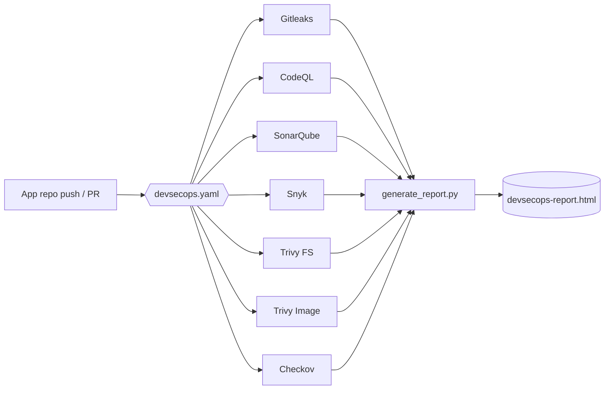

# DevSecOps Reusable Security Pipeline

A **centralised, reusable GitHub Actions workflow** that adds a full security scanning suite to any repository with ~15 lines of YAML. It runs seven scanners in parallel, enforces a severity-based security gate, and merges every result into a single HTML report.


## Why

Copying security jobs into every repository leads to drift: different tool versions, different thresholds, and gaps. This repo is the single source of truth. Application repos call it with `workflow_call`, so an improvement here reaches every consumer at once.

## What it scans

| Job | Tool | Covers | Gate |
|---|---|---|---|
| Secrets | **Gitleaks** | Hard-coded credentials across full git history | Fails on any leak |
| SAST | **CodeQL** | Code-level vulnerabilities (language configurable) | Results to Security tab |
| Code quality | **SonarQube / SonarCloud** | Bugs, code smells, security hotspots | Quality gate |
| SCA | **Snyk** | Vulnerable open-source dependencies | Fails on HIGH+ |
| Filesystem | **Trivy (fs)** | Dependency CVEs and misconfigurations | Fails on HIGH/CRITICAL |
| Container | **Trivy (image)** | OS and library CVEs in the built Docker image (optional) | Fails on HIGH/CRITICAL |
| IaC | **Checkov** | Terraform, Kubernetes, CloudFormation, Dockerfile | Fails on policy violation |

Each scanner first writes a **full SARIF report** (all severities, never fails) and then runs a separate **gate step** that fails only on HIGH/CRITICAL. You keep complete visibility without blocking on low-risk noise.

## Pipeline flow



## Consolidated HTML report

`scripts/generate_report.py` downloads every SARIF artifact, normalises severities across tools (numeric CVSS scores, string levels, rule tags, SARIF `level`), extracts package, installed and fixed versions, and renders one HTML report with severity summary cards. It is uploaded as the `devsecops-html-report` artifact on every run, pass or fail.

## Usage

In any application repository, add `.github/workflows/security.yaml`:

```yaml
name: Application Security
on: [push, pull_request]

permissions:
  contents: read
  actions: read
  security-events: write

jobs:
  security:
    uses: chandru05092001/devsecops-workflows/.github/workflows/devsecops.yaml@main
    with:
      sonar_project_key: <org>_<repo>
      sonar_organization: <org>          # optional
      codeql_languages: python           # e.g. javascript, java, go
      docker_image_name: my-app          # optional: enables the image scan
    secrets: inherit
```

**Required secrets:** `SONAR_TOKEN`, `SNYK_TOKEN`

### Inputs

| Input | Required | Default | Description |
|---|---|---|---|
| `sonar_project_key` | yes | | SonarQube / SonarCloud project key |
| `sonar_organization` | no | `""` | SonarCloud organisation |
| `sonar_host_url` | no | `https://sonarcloud.io` | Self-hosted SonarQube URL |
| `codeql_languages` | yes | | Languages for CodeQL |
| `docker_image_name` | no | `""` | When set, builds and scans the Docker image |

## Live example

See [devsecops-demo-app](https://github.com/chandru05092001/devsecops-demo-app), which consumes this pipeline.
